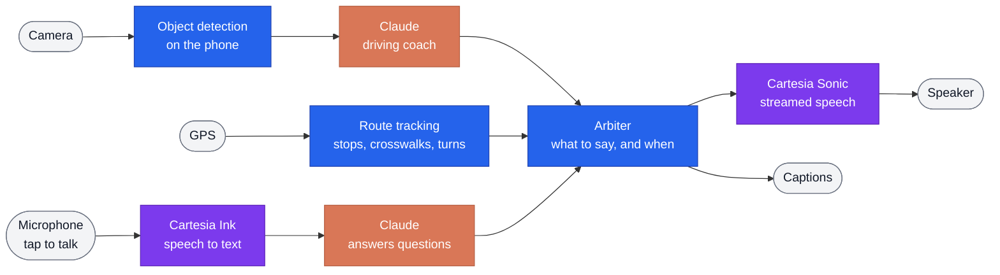

# Voya - the voice co-pilot for student/learning drivers

Voya is a proactive, speech-first AI coach for supervised practice drives. The product is geared toward hesitant student drivers who want extra coaching, and it supplements parents/guardians/adults who may not be comfortable teaching driving. A phone on the dashboard watches the road, follows the route, and talks the learner through what matters: a stop sign ahead, a cyclist on the right, a pedestrian crossing, a turn coming up. Tap the mic to ask a question/clarification out loud and hear a concise answer back.

Given the risky, high-stress environment, everything is voiced, so focus stays on the road. Captions show each line for the supervisor.

**[Try the live app](https://learner-copilot-ten.vercel.app?_vercel_share=H4bC3GofUEuPJZu2FCiWokznIXFJFDZJ)**

## How it works



<sub>Blue runs on the phone · orange is Claude · purple is Cartesia</sub>

- **Video never leaves the phone.** Only a short text description of what the detector sees goes to Claude.
- **Claude decides what's worth saying** and how it should sound, or stays quiet.
- **The arbiter** speaks one line at a time, puts the learner's questions first, and keeps lines from piling up.
- **Built-in guardrails (Safety/Compliance):** Voya never tells the driver to brake, never says a road is clear, and never decides right-of-way. A licensed adult supervises every drive.

## Setup steps

### Try it (no install)

1. Open the **[live app](https://learner-copilot-ten.vercel.app?_vercel_share=H4bC3GofUEuPJZu2FCiWokznIXFJFDZJ)** in Chrome or on your phone, and tick the supervisor checkbox.
2. Pick **Start live drive** (phone in a car): tap **Start drive** and allow camera, location and mic.
3. Tap the **mic** to ask a question; tap again to send.
4. Open **Timeline** to see every decision, and **Data use** to see what left the device.

### Run it locally

You need Node.js 22.6+, [Git LFS](https://git-lfs.com), and Cartesia and Anthropic API keys.

```bash
git lfs install
git clone https://github.com/nithila-sadheesh/calhacks13.git
cd calhacks13
npm install
cp .env.example .env      # add CARTESIA_API_KEY and ANTHROPIC_API_KEY
npm run dev               # open http://localhost:5173
```

- **On a phone:** run `npm run phone` for an HTTPS address on your network (phones need HTTPS for camera and mic).
- **Tests:** `npm test` and `npm run e2e`.
- **Deploy:** push to Vercel and set the same two keys as environment variables.

## Cartesia features we used

| Feature | How Voya uses it |
| --- | --- |
| **Sonic 3.6** (streaming TTS over WebSocket) | • Speaks every coaching line, reminder and answer<br>• Starts playing on the first audio chunk |
| **`generation_config`**: `emotion`, `speed`, `volume` | • Claude sets all three for every sentence<br>• Firm and louder for a stop sign, softer for reassurance |
| **`context_id`** + cancel | • Cuts a line off cleanly when a warning interrupts or the drive pauses |
| **`max_buffer_delay_ms: 0`** | • Short sentences start speaking right away |
| **Ink-2** (streaming speech-to-text) | • Tap-to-talk questions<br>• Instant "repeat", "mute" and "unmute" |
| **Access tokens** | • The browser gets a 5-minute token; the API key stays on our server |
| **Batch TTS** (`/tts/bytes`) | • Pre-recorded warnings that play instantly, even on a slow network |

## Known limitations

| Limitation | Future work/fixes |
| --- | --- |
| **Sees in 2D.** Can't judge real distance or speed, or read lane markings. | Depth estimation or a road-scene model |
| **Coaching latency** while Claude responds. | A small on-device model for instant first cues |
| **Route reminders need mapped areas.** Elsewhere it still coaches from the camera. | Fetch map data live for any route |
| **Tap-to-talk** | A hands-free wake word and more languages |

---

Built at Cal Hacks by Rohit, Nithila, Tejas and Jeev.
