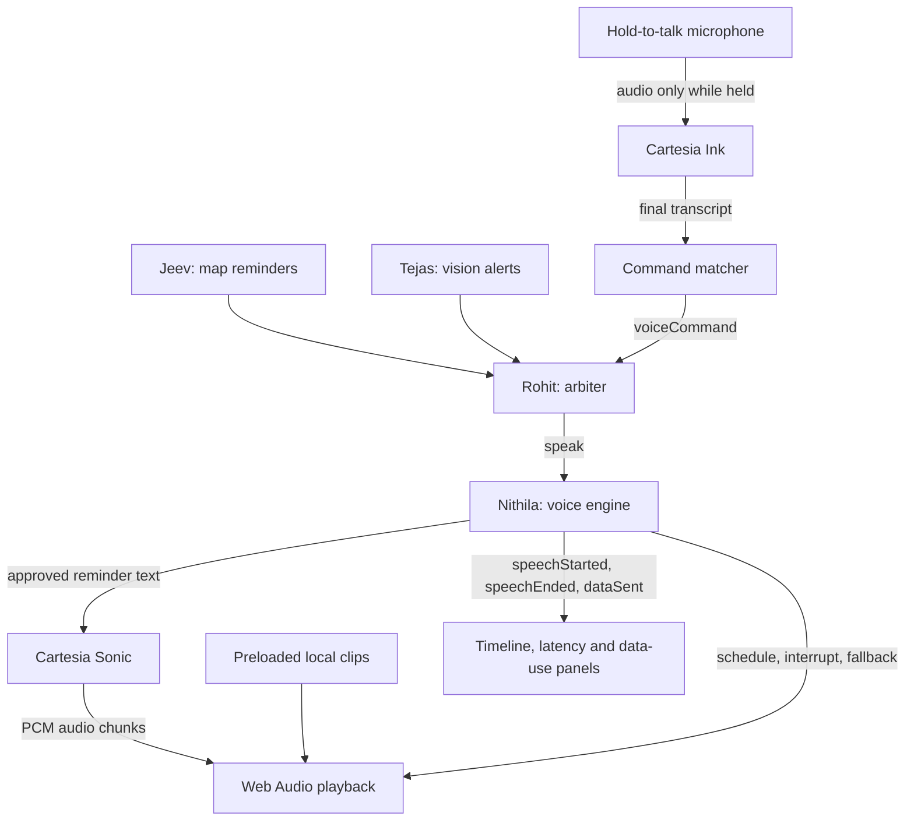

# Nithila's Task Summary: Cartesia Voice, Server and Deployment

## What I built

My part of Learner Co-Pilot is the voice system: it speaks approved driving reminders, interrupts them with urgent warnings, listens for a small set of push-to-talk commands, and protects the Cartesia API key on the server.

The voice module executes requests from the shared event bus. Rohit's arbiter decides which reminder should be spoken, its priority, and what happens when the learner requests repeat, mute or unmute. The voice module does not make driving decisions or use an LLM.

## Task-by-task overview

| Task | What it does | Why it is needed | Status |
| --- | --- | --- | --- |
| 1. Cartesia spike | Separate test page verifies Sonic speech, local interruption and microphone transmission to Ink. | Tests the API and browser-audio assumptions before integration. | Implemented; Nithila reported successful speech and clean interruption. |
| 2. Token endpoint | `GET /api/cartesia-token` exchanges the server-side API key for a five-minute token with TTS/STT grants. Includes basic rate limiting and safe errors. | Gives the browser temporary access without exposing the permanent key. | Implemented and unit-tested; a replacement key passed live authentication diagnostics. |
| 3. Sonic streaming | Sends a full approved reminder over a shared WebSocket, decodes incoming PCM, and schedules chunks back to back. Reconnects after a drop or on the next request. | Starts speaking without waiting for a whole audio file. | Implemented and unit-tested. |
| 4. Clean interruption | Stops all scheduled local audio nodes, cancels the old context and discards late chunks before playing an urgent clip. | Network cancellation alone cannot stop audio already buffered in the browser. | Implemented and unit-tested; original spike interruption sounded clean to Nithila. |
| 5. Bundled clips | Generates six approved phrases using Sonic, saves real PCM files and a manifest, and preloads them at startup. | Urgent warnings can start immediately without a network round trip. | Generation succeeded; all six audio files are present. |
| 6. Network fallback | Uses a matching local turn, stop-sign or crosswalk clip if streaming fails or no first audio arrives within 1.5 seconds. Ends unmatched or expired requests without speech. | Avoids waiting indefinitely or playing a reminder too late. | Implemented and unit-tested; explicit Wi-Fi-off acceptance remains to be recorded. |
| 7. Latency reporting | Measures from receipt of a speech request to the first buffer reaching the browser's audio output clock. Displays the latest value in VoicePanel. | Measures responsiveness at playback rather than network arrival. | Implemented and unit-tested; browser estimate, not an external acoustic measurement. |
| 8. Ink push-to-talk | Captures mic audio while held, finalizes transcription after release, and recognizes repeat/repeat-that, mute and unmute. | Enables limited voice interaction without always-on listening or an LLM. | Implemented and unit-tested; live recognition and mic-permission acceptance require confirmation. |
| 9. Data-use events | Publishes TTS reminder text and STT audio duration on the shared bus. | Lets the app's data-use panel show what leaves the device. | Implemented and unit-tested. |
| 10. Deployment setup | Configures Vercel's Vite build and token function, with deployment instructions and a readiness checker. | Provides a path to a shared HTTPS demo URL. | Configuration ready; actual Vercel deployment and preview URL are pending. |

## Technology stack

| Technology | Role |
| --- | --- |
| TypeScript | Typed voice logic, API handling, event payloads and tests. |
| React | VoicePanel: enable sound, latency, push-to-talk and status messages. |
| Vite | Local development and production frontend build, including a separate AudioWorklet asset. |
| Node.js | Local launcher, authentication diagnostics, clip generator and deployment checks. |
| Vercel Functions | Intended hosting for the server-side token endpoint. |
| Cartesia Sonic 3.6 | Live text-to-speech and generation of bundled warning/fallback clips. |
| Cartesia Ink-2 | Speech-to-text for push-to-talk commands. |
| WebSockets | Live Sonic audio delivery and Ink audio/transcript exchange. |
| Web Audio API | PCM playback, chunk scheduling, output-clock timing and immediate local cancellation. |
| AudioWorklet | Captures mono mic samples in short 20 ms frames; does not monitor the mic through the speakers. |
| Vitest | Deterministic unit tests for playback, networking, mic lifecycle, tokens and clip generation. |
| ESLint / TypeScript compiler | Enforce code rules and check types. |

There is no database and no LLM in this voice path.

### Current Cartesia configuration

- API version: `2026-08-14`.
- TTS model: `sonic-3.6`, with calm emotion guidance.
- Voice: Skylar, `db6b0ed5-d5d3-463d-ae85-518a07d3c2b4`.
- Speech output: raw mono `pcm_s16le` at 24,000 Hz.
- STT model: `ink-2`, manual finalization over `/stt/websocket`.
- Mic sample rate: the actual AudioContext rate, normally 48,000 Hz, sent in the Ink connection parameters.

## How the components connect



### A normal reminder

1. Jeev's module identifies an approaching route feature and publishes a cue.
2. Rohit's arbiter checks priority, expiry, spacing and whether another sound is playing.
3. The arbiter publishes `speak`.
4. The voice engine asks Sonic to generate the text and plays incoming audio chunks.
5. `speechStarted` carries the playback latency; `speechEnded` reports completion or interruption.
6. The larger app uses those events to update its timeline and voice display.

### An urgent warning

Tejas detects a pedestrian in real video frames. The arbiter decides to issue a priority-zero request. The voice engine stops all lower-priority sound locally, invalidates the old network context and plays the preloaded pedestrian clip. A late Sonic response cannot restart the interrupted sentence. Another priority-zero warning is not interrupted.

### A spoken command

The supervisor or parked learner holds the button and waits for Listening. AudioWorklet frames go to Ink only during the held session. Release stops capture and microphone tracks immediately. Ink finalizes the utterance; supported speech becomes `voiceCommand`. Rohit's arbiter owns repeating the previous reminder and applying mute/unmute while preserving urgent warnings.

Other speech is ignored. Reset, pause, end, unmount and cancellation clean up microphone state; old transcripts cannot execute in a new session.

### Authentication

```text
Browser -> /api/cartesia-token -> Cartesia access-token API
Browser <- temporary token    <- Cartesia
Browser -> Sonic / Ink directly using the temporary token
```

The permanent API key stays in the git-ignored local `.env` or Vercel's server environment. The server does not relay microphone audio or generated speech. Responses are marked `Cache-Control: no-store` and do not expose upstream error bodies or the permanent key.

The basic limiter allows 30 token requests per minute per warm server instance. It is not distributed user authentication; scaling and cold starts split or reset that limit.

### Local audio assets

`npm run clips` generates real Sonic audio before the demo. It writes content-hashed PCM files and atomically publishes the manifest only after all six requests succeed. The app preloads those assets at startup.

| Clip key | Spoken phrase |
| --- | --- |
| `pedestrianNearby` | Pedestrian ahead. Stay alert. |
| `followingDistance` | Leave more space ahead. |
| `cameraPaused` | Camera paused. Route reminders only. |
| `turn` | Turn ahead. |
| `stopSign` | Stop sign ahead. |
| `crosswalk` | Crosswalk ahead. |

Once loaded, these clips can play without Wi-Fi. Reloading the entire app while offline is not supported because no service worker/offline app cache was added.

## Important files

- `app/src/voice/index.ts`: module startup, event subscriptions, cleanup and UI controls.
- `app/src/voice/engine.ts`: speech lifecycle, preemption, expiry and fallback.
- `app/src/voice/sonic.ts`: shared Sonic connection and request cancellation.
- `app/src/voice/player.ts`: Web Audio scheduling and output-clock timing.
- `app/src/voice/clips.ts`, `config.ts`: clip loading, approved phrases and API configuration.
- `app/src/voice/capture.ts`, `captureWorklet.js`: mic capture and cleanup.
- `app/src/voice/ink.ts`, `pushToTalk.ts`: transcription sessions and command recognition.
- `app/src/voice/VoicePanel.tsx`: user controls and latency/status display.
- `api/cartesia-token.ts`: Vercel endpoint entry point.
- `scripts/voice/tokenEndpoint.ts`: token service shared by Vercel and the local launcher.
- `scripts/voice/generateClips.ts`, `clipGeneration.ts`: generation and atomic asset publishing.
- `fixtures/audio/`: six generated audio files and their manifest.
- `scripts/voice/checkAuth.ts`, `checkDeployment.ts`: safe diagnostics/readiness checks.
- `app/src/voice/DEPLOYMENT.md`: Vercel and live acceptance instructions.

## Testing and current limits

At implementation handoff, all 72 unit tests, typecheck, lint and the production build passed. Tests cover playback/interruption, late chunks, reconnect, fallback deadlines, expiry, approved wording, output-clock timing, token safety/rate limiting, clip validation, stale environment keys, microphone cleanup, permission races and command recognition.

Nithila confirmed the original spike sounded good, successfully generated the clips and reported that the runtime test appeared to work. That report does not replace explicit acceptance checks on the demo laptop for Ink recognition, speaker latency, noisy-room performance and Wi-Fi-off playback. These need to be recorded honestly rather than inferred from unit tests.

The voice module publishes the correct events, but the full end-to-end demo still depends on the other owners' real map, vision, replay and arbiter implementations. The arbiter was a stub in this checkout when this work was implemented. Their code and shared contracts were not changed.

Actual Vercel deployment, server environment setup and a shared preview URL remain pending. See `app/src/voice/DEPLOYMENT.md`.

## Running locally

From the repository root, with the valid API key stored in `.env`:

```sh
npm ci
npm run clips
node --env-file=.env --experimental-strip-types scripts/voice/spikeServer.ts
```

- Main app: http://127.0.0.1:5173/
- Production voice integration test: http://127.0.0.1:5173/app/src/voice/runtime.html
- Original early spike: http://127.0.0.1:5173/app/src/voice/spike.html

The runtime page should show **6/6 bundled clips loaded**. Enable sound before playback. Hold to talk, release to finalize, and inspect command/data-use events. Stop an older launcher with Ctrl+C if port 5173 is occupied.

```sh
npm run typecheck
npm run lint
npm test
npm run build
node --env-file=.env --experimental-strip-types scripts/voice/checkDeployment.ts
```

## How to explain my work

> I built the app's voice layer using Cartesia Sonic for speech and Ink for push-to-talk commands. It listens to the shared event bus, streams route reminders, and interrupts them with preloaded warnings when the arbiter requests it. Fixed warnings work without the network after loading. A server endpoint protects our API key by issuing temporary browser tokens, and the voice layer reports playback latency and data use to the rest of the app.
